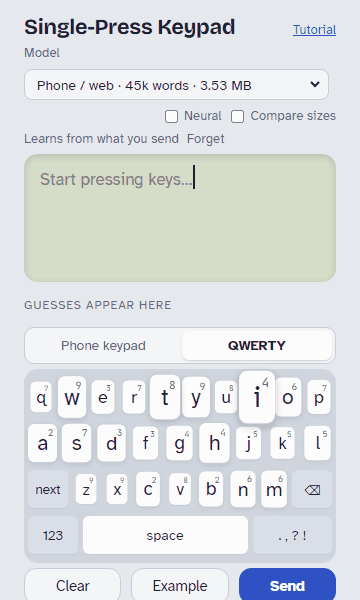

# OnePress

**One press per letter.** Type on a phone keypad, a radio or any small keyboard by pressing each
key once per letter (2 = abc, 3 = def, ...). A small word model reads the whole sentence and picks
the letters, so `66 0 69 0 929 0 4663` becomes "On my way home".

<p align="center"> </p>

**[Try the demo →](https://jamesdavid.github.io/OnePress-Keyboard/)** It runs entirely in your
browser, and a short tutorial starts on your first visit.

- **Whole-sentence context.** Each new word can fix the ones before it: `4663` alone is "good",
  after "on my way" it's "home". A finished sentence stays put once you start the next one.
- **On a radio.** The [OnePress firmware](https://github.com/JamesDavid/uv-k1-k5v3-firmware-custom/tree/onepress) for the Quansheng UV-K1 / UV-K5 V3 types
  messages on the keypad and sends them as APRS messages or Morse.
- **Small enough for microcontrollers.** One C99 file, no memory allocation, about 30 KB of code
  and 2–11 KB of RAM. The model is read straight from flash, or through a read function from
  SPI flash that isn't memory-mapped.
- **Forgives slips.** A word that no word matches is checked one slip away: a neighboring key, or
  a key pressed twice. With 3% of presses slipping, 87–89% of words still come out right (82% without).
- **Three model sizes** from 246 KB to 3.5 MB, for radios up to phones (the ESP32/Meshtastic and radio ones know CQ, QTH,
  QSO, tnx, fer, repeater, node and the like), and an optional neural
  network for phones and the web (6.3 MB, or 2.5 MB with almost the same gain).
- **Fifteen languages:** English, Spanish, German, Portuguese, French, Italian, Dutch, Swedish,
  Polish, Czech, Turkish, Russian, Greek, Arabic and Chinese, each in the three sizes (Chinese in
  two). Accents are typed on their plain letter's key and filled in for you (á on 2, ł on 5);
  Russian, Greek and Arabic use their usual phone keypads, and Arabic is shown right to left with
  ؟ and ،. German nouns are capitalized, Spanish questions open with ¿, apostrophes work as each
  language uses them (`l#homme` gives "l'homme", `tom#a` gives "Tom'a"), and `#` joins words with
  a hyphen (`well#known` gives "well-known"). 96–98.7% of words right on held-out sentences,
  against 83–95% for a classic keypad; Arabic, whose keypad puts far more common words on the
  same keys, 81–82% against 66%.
  - **Chinese:** type toneless pinyin, one press per letter, and the sentence picks the
    characters (`426` is hao, gao or gan: 好 号 高 干 感…). No spaces between words: the decoder
    finds the words itself, and `0` commits the characters, as space does on Chinese keyboards.
    88.7% of characters right with spaces (a classic pinyin keypad that takes each word's
    commonest characters: 81.9%), 84.2% without.
- **Fix any word without deleting.** Move back to an earlier word and cycle its guesses; the
  rest of the sentence re-decodes around your choice. Arrow keys where a device has them (the
  UV-K1's UP / DOWN, ← → on a computer), or hold `*` for edit mode on a plain keypad.
- **Learns from you.** Names, slang and call signs you spell once are guessed from their keys
  after that, and your own word habits and punctuation get more likely. Recent messages count too.
- **Capitals are automatic.** Sentence starts, names and brands (iPhone, McDonald's), the words
  around a word ("in May" but "I may", "Will Smith"), and call signs (KE7AQA).
- **Numbers, money and times.** Hold a number key for its digit: `# 6 # 000 # 00` gives
  "$6,000.00", and "at 5 # 30" gives "at 5:30" (5.30 is one tap away).
- **Exact spelling** (multi-tap) for anything else, mixed freely with predicted words.
- **Letter keyboards too, in each language's layout** (QWERTY, QWERTZ, AZERTY, Russian, Greek,
  Arabic, ...), arranged like the iOS keyboard. The letters you tap count, and a tap on a
  neighboring key is forgiven: with one letter in ten on the wrong key, 96.8% of English words
  still come out right, against 92.3% for one-word-at-a-time autocorrect. A word it doesn't know
  keeps the letters you tapped.
  - **accept / next:** where iOS has shift. Tap it to accept the suggested completion (shown in
    gray), or for the next guess when there's none; hold it for the next guess.
  - **Delete:** hold ⌫ to delete a word at a time.
- **Words run together.** A long word it doesn't know is tried as known words written as one
  ("icecreamtruck", "snowmanparty", "lollypops"), ranked by the compounds wordfreq knows and how
  often each word starts or ends one, with the other splits a tap away.
- **Identical decoders** in C and JavaScript, checked against each other on 11,000 inputs.

## Keys

| Key | Tap | Hold |
|---|---|---|
| `2`–`9` | a letter on that key | the digit |
| `0` | space (Chinese: commit) | the digit 0 |
| `#` | punctuation (the model picks `. , ? !`); between letters, an apostrophe | exact spelling on/off |
| `*` | take the gray completion of the word being typed, else the next guess for the selected word | edit mode on/off |
| `1` | delete | the digit 1 |

Apostrophes are optional ("dont" gives "don't").

**Edit mode** fixes an earlier word on a keypad with no arrow keys. Hold `*`: the word before the
last is selected. `0` and `#` move back and forward a word, and `*` cycles its guesses, best first
for the whole sentence; the words around it re-decode. Hold `*` again, or just keep typing, to go
back to the end with the fixes kept. On the demo page you can also tap a word, or use `‹ ›` and the
arrow keys.

## Accuracy, and how it compares

Everything here is measured on text the models never saw. There are two English test sets:

- **Texting:** real text messages from people the models never saw (NUS SMS corpus, US/Canada
  users), full of shorthand.
- **Chat:** modern written chat (Topical-Chat's test split).

The scripts in `tests/` reproduce every number.

### On a keypad: one press per letter

| Method | Presses per letter | Texting: words right | Chat: words right | Texting: punctuation |
|---|---|---|---|---|
| Multi-tap (press 7 four times for "s") | **2.15**, plus a pause every ~10 letters | 100% | 100% | typed |
| Classic predictive keypad (one word at a time) | 1 | 89.1% | 95.2% | 19% |
| **OnePress** (`onepress.bin`) | 1 | **94.1%** | **98.6%** | **49.8%** |
| **OnePress** + neural network | 1 | **95.0%** | **99.0%** | **55.4%** |

**Compared with multi-tap:**
- Multi-tap is always right, but it costs more than twice the presses.
- You also have to wait whenever two letters in a row share a key.

**Compared with a classic predictive keypad:** both take one press per letter, but the classic
one picks each word alone, by how common it is. OnePress makes far fewer mistakes:

| Wrong words per 100 | Classic keypad | OnePress | OnePress + network |
|---|---|---|---|
| Texting | 10.9 | 5.9 (46% fewer) | 5.0 (54% fewer) |
| Chat | 4.8 | 1.4 (71% fewer) | 1.0 (79% fewer) |

**Why it's better:**
- **It reads the whole sentence.** `4663` is "good", "home" or "gone", and only the words around
  it say which. A later word can still fix an earlier one, so "on my way" turns `4663` into
  "home".
- **It picks punctuation** from the sentence, so a question gets "?". A classic keypad only gives
  "." unless you cycle through the marks.

| Model | Size | Texting: words | Texting: punctuation | Chat: words | Chat: punctuation | For |
|---|---|---|---|---|---|---|
| `onepress.bin` + `onepress-nn.bin` | 3.5 MB + 6.3 MB | **95.0%** | **55.4%** | **99.0%** | **70.9%** | phones, web |
| `onepress.bin` + `onepress-nn-s.bin` | 3.5 MB + 2.5 MB | 94.9% | 52.7% | 98.9% | 70.2% | phones, web |
| `onepress.bin` (45k words) | 3.5 MB | 94.1% | 49.8% | 98.6% | 67.7% | phones, web |
| `onepress-m.bin` + `onepress-nn-m.bin` | 1.5 MB + 1.7 MB | 94.4% | 51.0% | 98.8% | 69.2% | ESP32 with flash to spare |
| `onepress-m.bin` (29k words, plus radio words) | 1.5 MB | 94.1% | 47.2% | 98.5% | 65.2% | ESP32, Meshtastic |
| `onepress-r.bin` (13k words, plus radio words) | 491 KB | 92.0% | 47.8% | 98.4% | 65.1% | UV-K1 radios |
| `onepress-s.bin` (5k words, plus radio words) | 246 KB | 89.0% | 46.7% | 98.5% | 64.9% | radios, nRF52 |
| A classic one-word-at-a-time keypad | | 89.1% | 19% | 95.2% | 49% | |

Texting words count a word the model lacks as wrong; chat words count it as spelled out exactly
(`--oov-exact`). The small models lack more words: 3.6% of texting words for `onepress-r.bin`,
8.3% for `onepress-s.bin`, which are typed with multi-tap. With those spelled out on both sides,
against a classic keypad with the same dictionary: `onepress-r.bin` 94.9% vs 90.0% of texting
words, `onepress-s.bin` 96.2% vs 91.4%; on radio messages 96.0% vs 78.9% and 95.9% vs 81.9%.

**Other languages** are measured on held-out Tatoeba sentences (`tests/eval.js --oov-exact`,
against `tests/baseline.js`):
- OnePress gets 96.1–98.7% of words right, against 83–95% for a classic keypad.
- Arabic is much harder: its keypad puts far more common words on the same keys, and words are
  written without short vowels. It gets 81–82%, against 66%.
- Chinese, typed as pinyin with a space between words: 86.0% of words and 88.7% of characters
  right, against 77.7% and 81.9% one word at a time; 84.2% of characters typed without spaces. Many of the misses are 他 / 她 / 它, all
  "ta".
- The full table is in [SPEC.md](SPEC.md).

**With learning:** replaying each person's messages in order (`node tests/learn_eval.js`, all 84
test users), words go from 90.2% to 93.1% and punctuation from 58.6% to 66.8%.

### On a letter keyboard (QWERTY and others)

Does the improvement hold on a full keyboard? **Yes, once taps miss.** To test it, each test
message is typed on QWERTY with a share of letters landing on a neighboring key, and the same
taps go to three methods:

- **Raw:** the letters exactly as tapped, with no correction.
- **Classic autocorrect:** one word at a time, it takes the most common dictionary word whose
  letters are each the tapped one or a neighbor (`tests/qwerty_eval.js --baseline word`).
- **OnePress:** the taps plus the whole sentence.

| Letters on a neighboring key | Raw | Classic autocorrect | **OnePress** |
|---|---|---|---|
| Texting, 0% | 100% | 99.97% | 99.66% |
| Texting, 3% | 87.4% | 97.2% | **98.7%** |
| Texting, 10% | 67.4% | 92.3% | **96.8%** |
| Chat, 0% | 100% | 99.81% | 99.41% |
| Chat, 3% | 86.7% | 97.5% | **98.9%** |
| Chat, 10% | 65.7% | 93.1% | **98.0%** |

- **With slips:** OnePress makes 55–71% fewer wrong words than one-word-at-a-time correction.
  The sentence tells it which neighbor you meant.
- **With perfect typing:** it is 0.3–0.4 points worse. Now and then the sentence overrides a short
  word typed correctly ("if" becomes "of").
- **Why not trust the taps more:** that fixes perfect typing, but loses more than it gains once
  even 3% of taps slip (tuned on the dev split).
- **Real phone keyboards (Gboard, iOS) aren't measured here.** They use context too, so they sit
  somewhere between the classic autocorrect column and OnePress.

Every language's own layout is measured the same way, in [SPEC.md](SPEC.md).

## Use it in your project

Copy `c/onepress.h`, `c/onepress.c` and a model, then:

```c
#include "onepress.h"

static op_model model;
static op_decoder dec;

op_model_open(&model, blob, blob_size);             /* blob: the .bin, 4-byte aligned, e.g. in flash */
op_decode(&dec, &model, "66069092904663", 8, NULL, NULL, 0);
char out[256];
op_render(&dec, &model, NULL, out, sizeof out);     /* "On my way home" */
```

Or in JavaScript, with `web/decoder.js`:

```js
const m = buildModel(new Uint8Array(await (await fetch('onepress.bin')).arrayBuffer()));
const r = decode(m, '66069092904663', {}, 8, 1);
render(m, r, r.hyps[0]).map(p => p.text).join('');   // "On my way home"
```

**[llm.txt](llm.txt)** is a step-by-step integration guide for iOS keyboard extensions, Android
input methods, the web, ESP32 (Meshtastic) and other microcontrollers: context from the text
before the cursor, learning, QWERTY layouts and the neural model. It's written so you can hand it
to a coding assistant.

## How it works

A key string such as `66069092904663` is split into words. Each word's keys match a handful of
dictionary words (`4663`: good, home, gone, hood, ...). A beam search over the sentence scores
each choice with word-pair and word-triple probabilities, so every word is chosen in the context
of its neighbours. Punctuation is chosen the same way, with a few rules about questions. The
model is a single binary file (KPD2) with sorted key indexes, so lookups are binary searches
straight from flash.

On phones and the web, a small recurrent neural network (KPN1, 8-bit integer weights) can also
score every candidate given everything typed before it. It runs inside the same search, in integer
arithmetic, so the C and JavaScript decoders still agree exactly. See [SPEC.md](SPEC.md) for the
details.

**The Neural checkbox** on the demo turns that network on. The word model judges each word by the
one or two words before it; the network reads the whole message so far, so it can use context from
further back. It helps most with punctuation, where a question often shows only in how the
sentence began:

| English texting | Words right | Punctuation right |
|---|---|---|
| Word model alone | 94.1% | 49.8% |
| + network (`onepress-nn-s.bin`, 2.5 MB) | 94.9% | 52.7% |
| + network (`onepress-nn.bin`, 6.3 MB) | 95.0% | 55.4% |

That is about 14% fewer wrong words. The cost is the download and speed: decoding takes roughly 15
times as long, which is fine on a phone or computer. It's English only so far. The checkbox shows
with the Phone model; `onepress-nn-m.bin` (1.7 MB) does the same for the ESP32 model (94.4% of
words against 94.05%). Radios and nRF52 boards go without.

## Repository

| Path | What |
|---|---|
| `c/` | C99 decoder (`onepress.h`, `onepress.c`) and a command-line test driver |
| `web/decoder.js` | JavaScript decoder (the reference) |
| `web/page.template.html` | Demo page source; `web/keypad.html` is the built page |
| `model/` | Model build pipeline, the three `.bin` word models and the neural model |
| `tests/` | Accuracy, learning, layout and C/JS parity tests |
| `python/` | An experimental version that uses a large language model |
| `SPEC.md` | Full specification |
| `llm.txt` | Integration guide |
| `DATA.md` | Where the training data comes from, and its terms |
| `BACKLOG.md` | Planned work: the T-Echo Lite Meshtastic port, Chinese next steps, Japanese |

## Build and test

```bash
gcc -std=c99 -O2 -Wall -Wextra -o build/opdecode c/onepress.c c/opdecode.c
node tests/parity.js              # C and JS give identical output
node tests/parity.js --learn      # ... while learning
node tests/parity.js --nn model/onepress-nn.bin   # ... with the neural model
node tests/eval.js                # held-out accuracy (needs the corpora: model/fetch_corpora.sh)
node tests/eval.js model/corpora/zh/test.txt --model model/onepress-zh.bin --no-spaces   # Chinese
cd model && ./build.sh            # rebuild the word models and the demo page (pip install wordfreq)
```

## License

The code is under the [PolyForm Noncommercial License 1.0.0](LICENSE): free for personal use,
hobby projects, research, education, and noncommercial organizations. **Commercial use**, such as
a paid or ad-supported keyboard app or a product that ships the decoder, **needs a separate
license**; contact the author through [GitHub](https://github.com/JamesDavid).

The model files are [CC BY-SA 4.0](https://creativecommons.org/licenses/by-sa/4.0/), because their
word frequencies come from [wordfreq](https://github.com/rspeer/wordfreq). [DATA.md](DATA.md) lists
every source, its terms, and the attribution to include.
