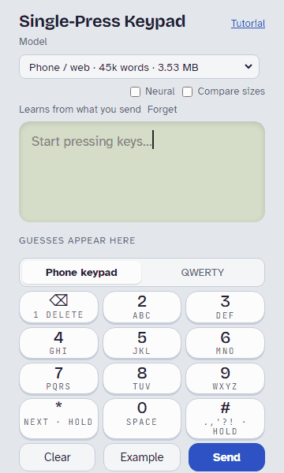

# OnePress

**One press per letter.** Type on a phone keypad, a radio or any small keyboard by pressing each
key once per letter (2 = abc, 3 = def, ...). A small word model reads the whole sentence and picks
the letters, so `66 0 69 0 929 0 4663` becomes "On my way home".

<p align="center"></p>

**[Try the demo →](https://jamesdavid.github.io/OnePress-Keyboard/)** It runs entirely in your
browser, and a short tutorial starts on your first visit.

- **Whole-sentence context.** Each new word can fix the ones before it: `4663` alone is "good",
  after "on my way" it's "home". A finished sentence stays put once you start the next one.
- **Small enough for microcontrollers.** One C99 file, no memory allocation, about 30 KB of code
  and 7–28 KB of RAM. The model is read straight from flash.
- **Forgives slips.** A word that no word matches is checked one slip away: a neighboring key, or
  a key pressed twice. With 3% of presses slipping, 87–89% of words still come out right (82% without).
- **Three model sizes** from 239 KB to 3.5 MB, for radios up to phones, and an optional neural
  network for phones and the web (6.3 MB, or 2.5 MB with almost the same gain).
- **Thirteen languages:** English, Spanish, German, Portuguese, French, Italian, Dutch, Swedish,
  Polish, Czech, Turkish, Russian and Greek, each in the three sizes. Accents are typed on their
  plain letter's key and filled in for you (á on 2, ł on 5); Russian and Greek use their usual
  phone keypads. German nouns are capitalized, Spanish questions open with ¿, and apostrophes
  work as each language uses them (`l#homme` gives "l'homme", `tom#a` gives "Tom'a"). 96–98.7%
  of words right on held-out sentences, against 83–95% for a classic keypad.
- **Learns from you.** Names, slang and call signs you spell once are guessed from their keys
  after that, and your own word habits and punctuation get more likely. Recent messages count too.
- **Capitals are automatic.** Sentence starts, names and brands (iPhone, McDonald's), the words
  around a word ("in May" but "I may", "Will Smith"), and call signs (KE7AQA).
- **Numbers, money and times.** Hold a number key for its digit: `# 6 # 000 # 00` gives
  "$6,000.00", and "at 5 # 30" gives "at 5:30" (5.30 is one tap away).
- **Exact spelling** (multi-tap) for anything else, mixed freely with predicted words.
- **Letter keyboards too, in each language's layout** (QWERTY, QWERTZ, AZERTY, Russian, Greek,
  ...). The letters you tap count, and a tap on a neighboring key is forgiven: in English 99.7%
  of words right typing accurately, 96.8% with one letter in ten on the wrong key. A word it
  doesn't know keeps the letters you tapped.
- **Words run together.** A long word it doesn't know is tried as known words written as one
  ("icecreamtruck", "snowmanparty", "lollypops"), ranked by the compounds wordfreq knows and how
  often each word starts or ends one, with the other splits a tap away.
- **Identical decoders** in C and JavaScript, checked against each other on 11,000 inputs.

## Keys

| Key | Tap | Hold |
|---|---|---|
| `2`–`9` | a letter on that key | the digit |
| `0` | space | the digit 0 |
| `#` | punctuation (the model picks `. , ? !`); between letters, an apostrophe | exact spelling on/off |
| `*` | next guess for the selected word | finish the word |
| `1` | delete | the digit 1 |

Apostrophes are optional ("dont" gives "don't").

## Accuracy

Two held-out test sets: real text messages from people the models never saw (NUS SMS corpus,
US/Canada users, with plenty of texting shorthand) and modern written chat (Topical-Chat's test
split, words the model lacks spelled out). `node tests/eval.js`:

| Model | Size | Texting: words | Texting: punctuation | Chat: words | Chat: punctuation | For |
|---|---|---|---|---|---|---|
| `onepress.bin` + `onepress-nn.bin` | 3.5 MB + 6.3 MB | **95.0%** | **55.4%** | **99.0%** | **70.9%** | phones, web |
| `onepress.bin` + `onepress-nn-s.bin` | 3.5 MB + 2.5 MB | 94.9% | 52.7% | 98.9% | 70.2% | phones, web |
| `onepress.bin` (45k words) | 3.5 MB | 94.1% | 49.8% | 98.6% | 67.7% | phones, web |
| `onepress-m.bin` + `onepress-nn-m.bin` | 1.5 MB + 1.7 MB | 94.4% | 49.7% | 98.8% | 69.2% | ESP32 with flash to spare |
| `onepress-m.bin` (29k words) | 1.5 MB | 94.1% | 47.1% | 98.5% | 65.1% | ESP32, Meshtastic |
| `onepress-s.bin` (5k words) | 239 KB | 89.0% | 46.6% | 98.5% | 64.9% | radios, nRF52 |
| A classic one-word-at-a-time keypad | | 89.1% | 19% | 95.2% | 49% | |

Spanish (`onepress-es.bin`, 1.9 MB): 97.9% of words right on held-out Tatoeba sentences, accents
included (a classic keypad: 91.7%). QWERTY: 99.6% of words right typing accurately, 96.5% with
one tap in ten on a neighboring key (`tests/qwerty_eval.js`).

With learning, replaying each person's messages in order (`node tests/learn_eval.js`, all 84 test
users): words go from 90.2% to 93.1%, and punctuation from 58.6% to 66.8%.

## Use it in your project

Copy `c/onepress.h`, `c/onepress.c` and a model, then:

```c
#include "onepress.h"

static op_model model;
static op_decoder dec;

op_model_open(&model, blob, blob_size);             /* blob: the .bin, 4-byte aligned, e.g. in flash */
op_decode(&dec, &model, "66069092904663", 8, NULL, NULL, 0);
char out[256];
op_render(&dec, &model, NULL, out, sizeof out);     /* "On my way home" */
```

Or in JavaScript, with `web/decoder.js`:

```js
const m = buildModel(new Uint8Array(await (await fetch('onepress.bin')).arrayBuffer()));
const r = decode(m, '66069092904663', {}, 8, 1);
render(m, r, r.hyps[0]).map(p => p.text).join('');   // "On my way home"
```

**[llm.txt](llm.txt)** is a step-by-step integration guide for iOS keyboard extensions, Android
input methods, the web, ESP32 (Meshtastic) and other microcontrollers: context from the text
before the cursor, learning, QWERTY layouts and the neural model. It's written so you can hand it
to a coding assistant.

## How it works

A key string such as `66069092904663` is split into words. Each word's keys match a handful of
dictionary words (`4663`: good, home, gone, hood, ...). A beam search over the sentence scores
each choice with word-pair and word-triple probabilities, so every word is chosen in the context
of its neighbours. Punctuation is chosen the same way, with a few rules about questions. The
model is a single binary file (KPD2) with sorted key indexes, so lookups are binary searches
straight from flash.

On phones and the web, a small recurrent neural network (KPN1, 8-bit integer weights) can also
score every candidate given everything typed before it. It runs inside the same search, in integer
arithmetic, so the C and JavaScript decoders still agree exactly. See [SPEC.md](SPEC.md) for the
details.

## Repository

| Path | What |
|---|---|
| `c/` | C99 decoder (`onepress.h`, `onepress.c`) and a command-line test driver |
| `web/decoder.js` | JavaScript decoder (the reference) |
| `web/page.template.html` | Demo page source; `web/keypad.html` is the built page |
| `model/` | Model build pipeline, the three `.bin` word models and the neural model |
| `tests/` | Accuracy, learning, layout and C/JS parity tests |
| `python/` | An experimental version that uses a large language model |
| `SPEC.md` | Full specification |
| `llm.txt` | Integration guide |
| `DATA.md` | Where the training data comes from, and its terms |

## Build and test

```bash
gcc -std=c99 -O2 -Wall -Wextra -o build/opdecode c/onepress.c c/opdecode.c
node tests/parity.js              # C and JS give identical output
node tests/parity.js --learn      # ... while learning
node tests/parity.js --nn model/onepress-nn.bin   # ... with the neural model
node tests/eval.js                # held-out accuracy (needs the corpora: model/fetch_corpora.sh)
cd model && ./build.sh            # rebuild the word models and the demo page (pip install wordfreq)
```

## License

The code is under the [PolyForm Noncommercial License 1.0.0](LICENSE): free for personal use,
hobby projects, research, education, and noncommercial organizations. **Commercial use**, such as
a paid or ad-supported keyboard app or a product that ships the decoder, **needs a separate
license**; contact the author through [GitHub](https://github.com/JamesDavid).

The model files are [CC BY-SA 4.0](https://creativecommons.org/licenses/by-sa/4.0/), because their
word frequencies come from [wordfreq](https://github.com/rspeer/wordfreq). [DATA.md](DATA.md) lists
every source, its terms, and the attribution to include.
